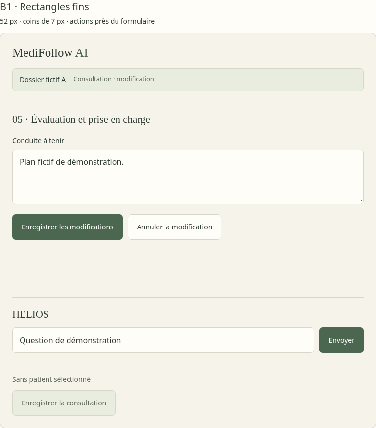
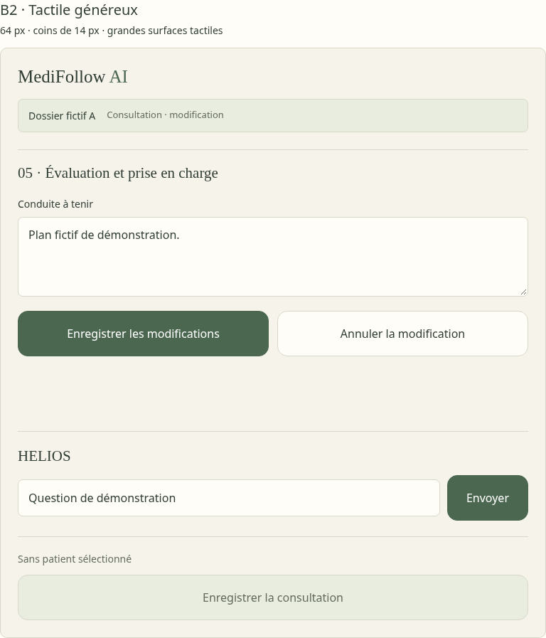
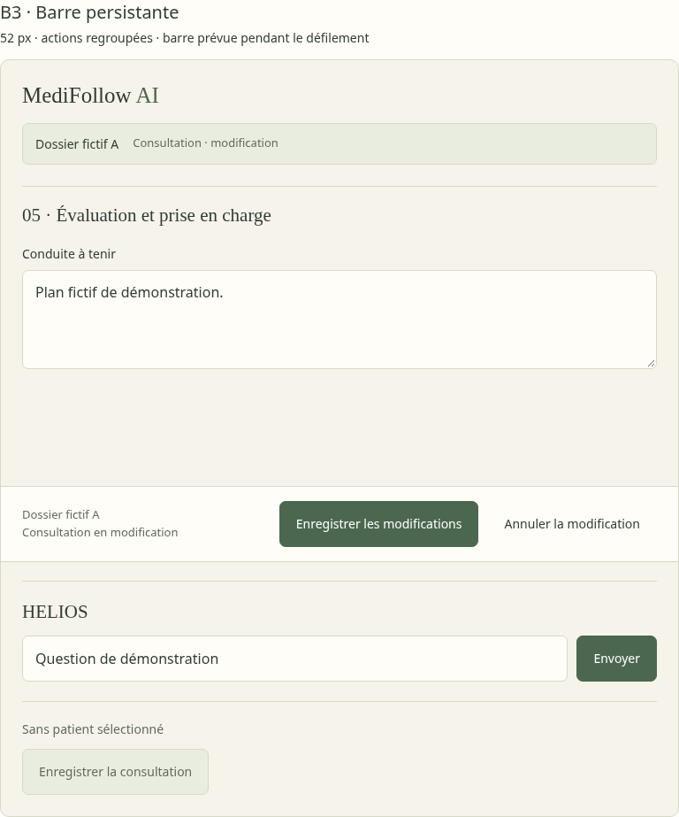

# Choix B1 / B2 / B3 — boutons et barres d’action

Après acceptation visuelle de F1, trois propositions pour le prochain choix. **Maquettes de composants, pas captures de l’application modifiée.** La palette C et les champs F1 restent identiques. Le code applicatif et la PR #14 sont inchangés.

Les planches montrent les mêmes exemples fictifs : modification d’une consultation, bouton Envoyer de HELIOS et sauvegarde désactivée sans patient sélectionné. Ces extraits sont juxtaposés pour comparer les boutons ; ils ne décrivent pas un nouveau parcours clinique.

## B1 — Rectangles fins

Boutons de 52 px minimum, coins de 7 px, dimensions adaptées au libellé. Action principale sauge, action secondaire à bordure fine, à proximité du formulaire. Proposition proche de l’existant, avec peu d’espace occupé.

## B2 — Tactile généreux

Boutons de 64 px minimum, coins de 14 px, surfaces plus larges. Deux colonnes quand l’espace suffit, empilement sur téléphone. Plus faciles à viser au doigt, ils prennent davantage de place. Les champs restent à 52 px.

## B3 — Barre persistante

Boutons de 52 px regroupés dans une barre séparée du contenu, avec rappel du dossier concerné et annulation discrète. L’intention est de conserver les actions accessibles pendant le défilement d’un long formulaire. La barre occuperait une partie du bas de la vue.

**Cette planche est une maquette de positionnement : la persistance au défilement n’est pas programmée dans l’application. Elle sera à implémenter et à tester seulement après choix utilisateur, notamment face à l’orbe HELIOS et au clavier Android.**

## Versions claires, sombres et mobiles

| Proposition | Tablette claire | Tablette sombre | Mobile clair | Mobile sombre |
|---|---|---|---|---|
| B1 | [Voir](b1.png) | [Voir](b1-800-dark.png) | [Voir](b1-360-light.png) | [Voir](b1-360-dark.png) |
| B2 | [Voir](b2.png) | [Voir](b2-800-dark.png) | [Voir](b2-360-light.png) | [Voir](b2-360-dark.png) |
| B3 | [Voir](b3.png) | [Voir](b3-800-dark.png) | [Voir](b3-360-light.png) | [Voir](b3-360-dark.png) |

Maquettes rasterisées dans Chromium Linux, aux largeurs de fenêtre 800 et 360 px. Elles ne constituent pas un test sur une tablette Android physique.

## Portée prévue après décision

Le choix définit le traitement des boutons d’action principaux et secondaires dans Dashboard, Patients, Consultations et examen physique, HELIOS, Ordonnances, Protocoles, Inventaire et Paramètres. Il conserve leurs libellés et conditions d’activation.

La navigation N3, les champs F1, les états médicaux, les commandes vocales et l’apparence de l’orbe ne font pas partie de ce choix. Les couleurs d’urgence/suppression et les confirmations existantes restent conservées. Aucun bouton ou acte clinique nouveau n’est proposé.

Pour B3, la barre concernerait les formulaires ayant déjà des actions de sauvegarde/annulation. Le bouton Envoyer de HELIOS resterait dans son composeur ; Dashboard et Protocoles conserveraient la position de leurs actions.

## Vérification des maquettes

[Mesures](checks.json) : 24 combinaisons (trois variantes × largeurs 320, 360, 800, 1280 × clair/sombre), sans débordement horizontal ni libellé de bouton rogné, cibles au moins 52 px, focus clavier visible, champs F1 identiques. [Source](mockups.html) et [script de capture](capture.py). Aucun test fonctionnel de l’application n’est annoncé par ces mesures de maquettes.

L’utilisateur peut retenir une proposition, combiner ses détails ou conserver l’existant. Aucun style n’est appliqué à l’application avant son choix. Aucun déploiement, fusion ni appel IA payant.
