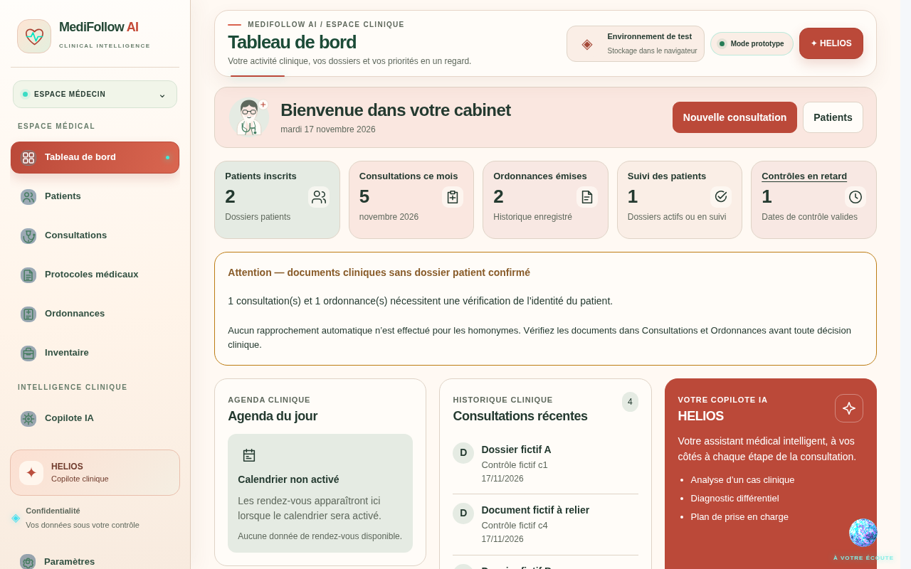
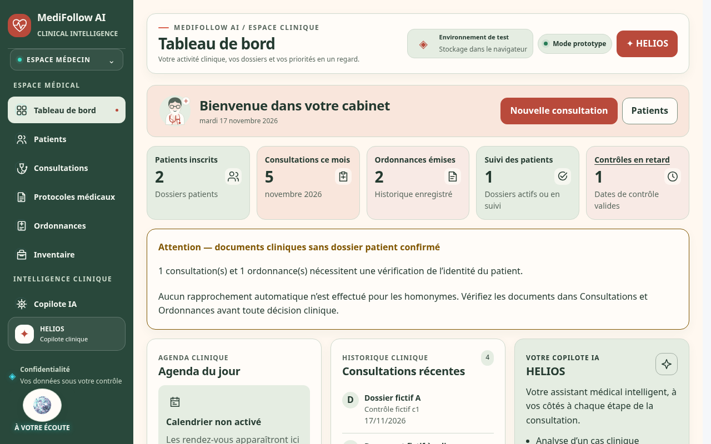
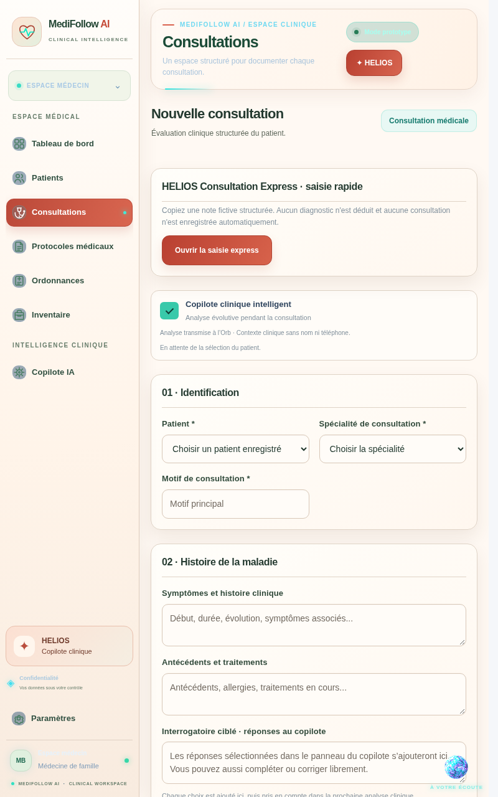
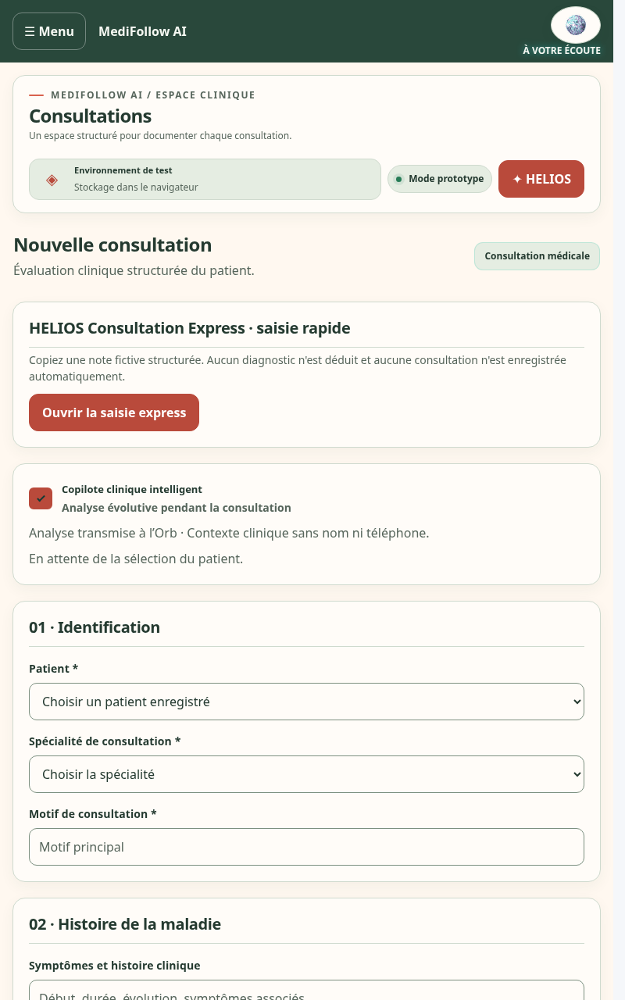
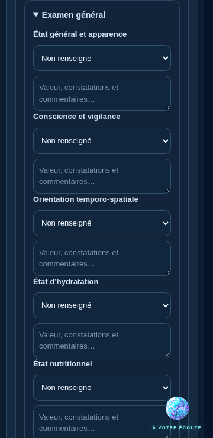
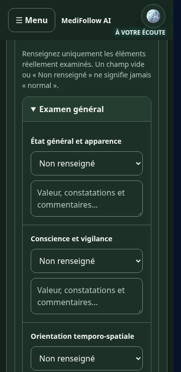
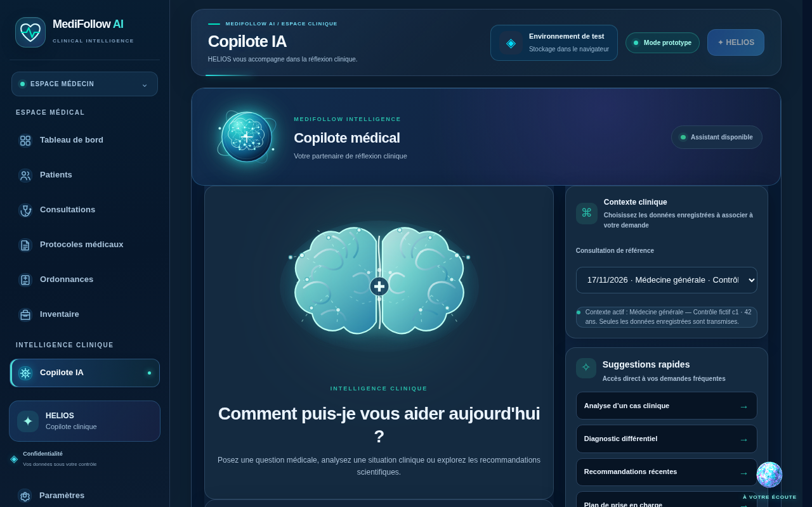
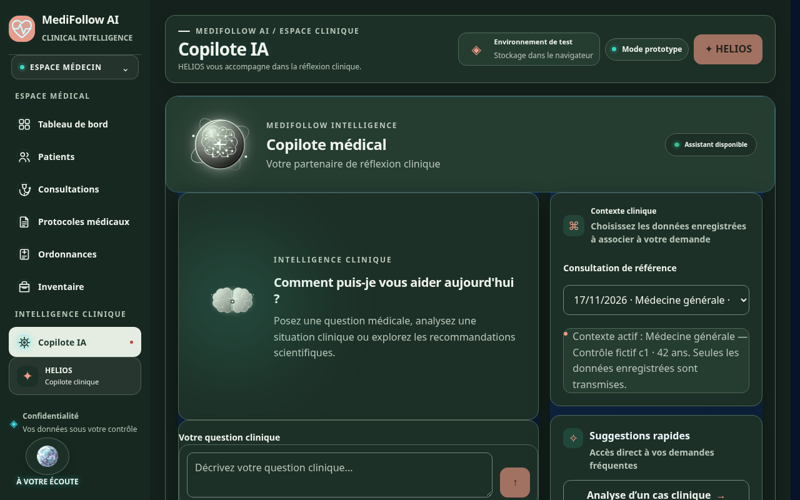

# Cabinet chaleureux A — galerie réelle avant/après

Charte A approuvée par l’utilisateur. Avant : `1cbd541c4cbe801f80c26eb4cfccf64e50a9be40`, PR #17 inchangée. Après : implémentation globale sur la branche `codex/cabinet-chaleureux-a-global`.

Les captures ci-dessous proviennent de Chromium et de dossiers entièrement fictifs. La [planche conceptuelle approuvée](charte-a-apercu.png) est distincte de ces captures. [Charte complète](CHARTE-A.md) · [Rapport et journaux](RAPPORT.md).

## Dashboard — 1280×800, clair

| Avant | Après |
|---|---|
|  |  |

## Consultations — tablette 800×1280, clair

| Avant | Après |
|---|---|
|  |  |

## Examen physique — 360×740, sombre

| Avant | Après |
|---|---|
|  |  |

## HELIOS — 1280×800, sombre

| Avant | Après |
|---|---|
|  |  |

## Les huit pages, dans chaque configuration

| Page | Dimensions | Thème | Avant | Après |
|---|---|---|---|---|
| Dashboard | 1280x800 | light | [Voir](avant/dashboard-1280x800-light.png) | [Voir](apres/dashboard-1280x800-light.png) |
| Dashboard | 1280x800 | dark | [Voir](avant/dashboard-1280x800-dark.png) | [Voir](apres/dashboard-1280x800-dark.png) |
| Dashboard | 800x1280 | light | [Voir](avant/dashboard-800x1280-light.png) | [Voir](apres/dashboard-800x1280-light.png) |
| Dashboard | 800x1280 | dark | [Voir](avant/dashboard-800x1280-dark.png) | [Voir](apres/dashboard-800x1280-dark.png) |
| Dashboard | 360x740 | light | [Voir](avant/dashboard-360x740-light.png) | [Voir](apres/dashboard-360x740-light.png) |
| Dashboard | 360x740 | dark | [Voir](avant/dashboard-360x740-dark.png) | [Voir](apres/dashboard-360x740-dark.png) |
| Dashboard | 1648x928 | light | [Voir](avant/dashboard-1648x928-light.png) | [Voir](apres/dashboard-1648x928-light.png) |
| Dashboard | 1648x928 | dark | [Voir](avant/dashboard-1648x928-dark.png) | [Voir](apres/dashboard-1648x928-dark.png) |
| Patients | 1280x800 | light | [Voir](avant/patients-1280x800-light.png) | [Voir](apres/patients-1280x800-light.png) |
| Patients | 1280x800 | dark | [Voir](avant/patients-1280x800-dark.png) | [Voir](apres/patients-1280x800-dark.png) |
| Patients | 800x1280 | light | [Voir](avant/patients-800x1280-light.png) | [Voir](apres/patients-800x1280-light.png) |
| Patients | 800x1280 | dark | [Voir](avant/patients-800x1280-dark.png) | [Voir](apres/patients-800x1280-dark.png) |
| Patients | 360x740 | light | [Voir](avant/patients-360x740-light.png) | [Voir](apres/patients-360x740-light.png) |
| Patients | 360x740 | dark | [Voir](avant/patients-360x740-dark.png) | [Voir](apres/patients-360x740-dark.png) |
| Patients | 1648x928 | light | [Voir](avant/patients-1648x928-light.png) | [Voir](apres/patients-1648x928-light.png) |
| Patients | 1648x928 | dark | [Voir](avant/patients-1648x928-dark.png) | [Voir](apres/patients-1648x928-dark.png) |
| Consultations | 1280x800 | light | [Voir](avant/consultations-1280x800-light.png) | [Voir](apres/consultations-1280x800-light.png) |
| Consultations | 1280x800 | dark | [Voir](avant/consultations-1280x800-dark.png) | [Voir](apres/consultations-1280x800-dark.png) |
| Consultations | 800x1280 | light | [Voir](avant/consultations-800x1280-light.png) | [Voir](apres/consultations-800x1280-light.png) |
| Consultations | 800x1280 | dark | [Voir](avant/consultations-800x1280-dark.png) | [Voir](apres/consultations-800x1280-dark.png) |
| Consultations | 360x740 | light | [Voir](avant/consultations-360x740-light.png) | [Voir](apres/consultations-360x740-light.png) |
| Consultations | 360x740 | dark | [Voir](avant/consultations-360x740-dark.png) | [Voir](apres/consultations-360x740-dark.png) |
| Consultations | 1648x928 | light | [Voir](avant/consultations-1648x928-light.png) | [Voir](apres/consultations-1648x928-light.png) |
| Consultations | 1648x928 | dark | [Voir](avant/consultations-1648x928-dark.png) | [Voir](apres/consultations-1648x928-dark.png) |
| HELIOS | 1280x800 | light | [Voir](avant/helios-1280x800-light.png) | [Voir](apres/helios-1280x800-light.png) |
| HELIOS | 1280x800 | dark | [Voir](avant/helios-1280x800-dark.png) | [Voir](apres/helios-1280x800-dark.png) |
| HELIOS | 800x1280 | light | [Voir](avant/helios-800x1280-light.png) | [Voir](apres/helios-800x1280-light.png) |
| HELIOS | 800x1280 | dark | [Voir](avant/helios-800x1280-dark.png) | [Voir](apres/helios-800x1280-dark.png) |
| HELIOS | 360x740 | light | [Voir](avant/helios-360x740-light.png) | [Voir](apres/helios-360x740-light.png) |
| HELIOS | 360x740 | dark | [Voir](avant/helios-360x740-dark.png) | [Voir](apres/helios-360x740-dark.png) |
| HELIOS | 1648x928 | light | [Voir](avant/helios-1648x928-light.png) | [Voir](apres/helios-1648x928-light.png) |
| HELIOS | 1648x928 | dark | [Voir](avant/helios-1648x928-dark.png) | [Voir](apres/helios-1648x928-dark.png) |
| Ordonnances | 1280x800 | light | [Voir](avant/ordonnances-1280x800-light.png) | [Voir](apres/ordonnances-1280x800-light.png) |
| Ordonnances | 1280x800 | dark | [Voir](avant/ordonnances-1280x800-dark.png) | [Voir](apres/ordonnances-1280x800-dark.png) |
| Ordonnances | 800x1280 | light | [Voir](avant/ordonnances-800x1280-light.png) | [Voir](apres/ordonnances-800x1280-light.png) |
| Ordonnances | 800x1280 | dark | [Voir](avant/ordonnances-800x1280-dark.png) | [Voir](apres/ordonnances-800x1280-dark.png) |
| Ordonnances | 360x740 | light | [Voir](avant/ordonnances-360x740-light.png) | [Voir](apres/ordonnances-360x740-light.png) |
| Ordonnances | 360x740 | dark | [Voir](avant/ordonnances-360x740-dark.png) | [Voir](apres/ordonnances-360x740-dark.png) |
| Ordonnances | 1648x928 | light | [Voir](avant/ordonnances-1648x928-light.png) | [Voir](apres/ordonnances-1648x928-light.png) |
| Ordonnances | 1648x928 | dark | [Voir](avant/ordonnances-1648x928-dark.png) | [Voir](apres/ordonnances-1648x928-dark.png) |
| Protocoles | 1280x800 | light | [Voir](avant/protocoles-1280x800-light.png) | [Voir](apres/protocoles-1280x800-light.png) |
| Protocoles | 1280x800 | dark | [Voir](avant/protocoles-1280x800-dark.png) | [Voir](apres/protocoles-1280x800-dark.png) |
| Protocoles | 800x1280 | light | [Voir](avant/protocoles-800x1280-light.png) | [Voir](apres/protocoles-800x1280-light.png) |
| Protocoles | 800x1280 | dark | [Voir](avant/protocoles-800x1280-dark.png) | [Voir](apres/protocoles-800x1280-dark.png) |
| Protocoles | 360x740 | light | [Voir](avant/protocoles-360x740-light.png) | [Voir](apres/protocoles-360x740-light.png) |
| Protocoles | 360x740 | dark | [Voir](avant/protocoles-360x740-dark.png) | [Voir](apres/protocoles-360x740-dark.png) |
| Protocoles | 1648x928 | light | [Voir](avant/protocoles-1648x928-light.png) | [Voir](apres/protocoles-1648x928-light.png) |
| Protocoles | 1648x928 | dark | [Voir](avant/protocoles-1648x928-dark.png) | [Voir](apres/protocoles-1648x928-dark.png) |
| Inventaire | 1280x800 | light | [Voir](avant/inventaire-1280x800-light.png) | [Voir](apres/inventaire-1280x800-light.png) |
| Inventaire | 1280x800 | dark | [Voir](avant/inventaire-1280x800-dark.png) | [Voir](apres/inventaire-1280x800-dark.png) |
| Inventaire | 800x1280 | light | [Voir](avant/inventaire-800x1280-light.png) | [Voir](apres/inventaire-800x1280-light.png) |
| Inventaire | 800x1280 | dark | [Voir](avant/inventaire-800x1280-dark.png) | [Voir](apres/inventaire-800x1280-dark.png) |
| Inventaire | 360x740 | light | [Voir](avant/inventaire-360x740-light.png) | [Voir](apres/inventaire-360x740-light.png) |
| Inventaire | 360x740 | dark | [Voir](avant/inventaire-360x740-dark.png) | [Voir](apres/inventaire-360x740-dark.png) |
| Inventaire | 1648x928 | light | [Voir](avant/inventaire-1648x928-light.png) | [Voir](apres/inventaire-1648x928-light.png) |
| Inventaire | 1648x928 | dark | [Voir](avant/inventaire-1648x928-dark.png) | [Voir](apres/inventaire-1648x928-dark.png) |
| Paramètres | 1280x800 | light | [Voir](avant/parametres-1280x800-light.png) | [Voir](apres/parametres-1280x800-light.png) |
| Paramètres | 1280x800 | dark | [Voir](avant/parametres-1280x800-dark.png) | [Voir](apres/parametres-1280x800-dark.png) |
| Paramètres | 800x1280 | light | [Voir](avant/parametres-800x1280-light.png) | [Voir](apres/parametres-800x1280-light.png) |
| Paramètres | 800x1280 | dark | [Voir](avant/parametres-800x1280-dark.png) | [Voir](apres/parametres-800x1280-dark.png) |
| Paramètres | 360x740 | light | [Voir](avant/parametres-360x740-light.png) | [Voir](apres/parametres-360x740-light.png) |
| Paramètres | 360x740 | dark | [Voir](avant/parametres-360x740-dark.png) | [Voir](apres/parametres-360x740-dark.png) |
| Paramètres | 1648x928 | light | [Voir](avant/parametres-1648x928-light.png) | [Voir](apres/parametres-1648x928-light.png) |
| Paramètres | 1648x928 | dark | [Voir](avant/parametres-1648x928-dark.png) | [Voir](apres/parametres-1648x928-dark.png) |

## Dossier, examen et Dashboard complet

| Vue | Dimensions | Thème | Avant | Après |
|---|---|---|---|---|
| Dossier patient | 1280x800 | light | [Voir](avant/dossier-1280x800-light.png) | [Voir](apres/dossier-1280x800-light.png) |
| Dossier patient | 1280x800 | dark | [Voir](avant/dossier-1280x800-dark.png) | [Voir](apres/dossier-1280x800-dark.png) |
| Dossier patient | 800x1280 | light | [Voir](avant/dossier-800x1280-light.png) | [Voir](apres/dossier-800x1280-light.png) |
| Dossier patient | 800x1280 | dark | [Voir](avant/dossier-800x1280-dark.png) | [Voir](apres/dossier-800x1280-dark.png) |
| Dossier patient | 360x740 | light | [Voir](avant/dossier-360x740-light.png) | [Voir](apres/dossier-360x740-light.png) |
| Dossier patient | 360x740 | dark | [Voir](avant/dossier-360x740-dark.png) | [Voir](apres/dossier-360x740-dark.png) |
| Dossier patient | 1648x928 | light | [Voir](avant/dossier-1648x928-light.png) | [Voir](apres/dossier-1648x928-light.png) |
| Dossier patient | 1648x928 | dark | [Voir](avant/dossier-1648x928-dark.png) | [Voir](apres/dossier-1648x928-dark.png) |
| Examen physique | 1280x800 | light | [Voir](avant/examen-1280x800-light.png) | [Voir](apres/examen-1280x800-light.png) |
| Examen physique | 1280x800 | dark | [Voir](avant/examen-1280x800-dark.png) | [Voir](apres/examen-1280x800-dark.png) |
| Examen physique | 800x1280 | light | [Voir](avant/examen-800x1280-light.png) | [Voir](apres/examen-800x1280-light.png) |
| Examen physique | 800x1280 | dark | [Voir](avant/examen-800x1280-dark.png) | [Voir](apres/examen-800x1280-dark.png) |
| Examen physique | 360x740 | light | [Voir](avant/examen-360x740-light.png) | [Voir](apres/examen-360x740-light.png) |
| Examen physique | 360x740 | dark | [Voir](avant/examen-360x740-dark.png) | [Voir](apres/examen-360x740-dark.png) |
| Examen physique | 1648x928 | light | [Voir](avant/examen-1648x928-light.png) | [Voir](apres/examen-1648x928-light.png) |
| Examen physique | 1648x928 | dark | [Voir](avant/examen-1648x928-dark.png) | [Voir](apres/examen-1648x928-dark.png) |
| Dashboard complet | 1280x800 | light | [Voir](avant/dashboard-1280x800-light-complet.png) | [Voir](apres/dashboard-1280x800-light-complet.png) |
| Dashboard complet | 1280x800 | dark | [Voir](avant/dashboard-1280x800-dark-complet.png) | [Voir](apres/dashboard-1280x800-dark-complet.png) |
| Dashboard complet | 800x1280 | light | [Voir](avant/dashboard-800x1280-light-complet.png) | [Voir](apres/dashboard-800x1280-light-complet.png) |
| Dashboard complet | 800x1280 | dark | [Voir](avant/dashboard-800x1280-dark-complet.png) | [Voir](apres/dashboard-800x1280-dark-complet.png) |
| Dashboard complet | 360x740 | light | [Voir](avant/dashboard-360x740-light-complet.png) | [Voir](apres/dashboard-360x740-light-complet.png) |
| Dashboard complet | 360x740 | dark | [Voir](avant/dashboard-360x740-dark-complet.png) | [Voir](apres/dashboard-360x740-dark-complet.png) |
| Dashboard complet | 1648x928 | light | [Voir](avant/dashboard-1648x928-light-complet.png) | [Voir](apres/dashboard-1648x928-light-complet.png) |
| Dashboard complet | 1648x928 | dark | [Voir](avant/dashboard-1648x928-dark-complet.png) | [Voir](apres/dashboard-1648x928-dark-complet.png) |

## Contrôles complémentaires

- Focus : [701 clair](focus-701-light.png), [800 sombre](focus-800-dark.png), [900 clair](focus-900-light.png), [360 sombre](focus-360-dark.png).
- Assistant ouvert : [tablette sombre](assistant-800-dark.png), [téléphone sombre](assistant-360-dark.png). Aucune activation du microphone ni envoi IA.
- Reflow équivalent à 200 % : [clair](reflow-640x400-light.png), [sombre](reflow-640x400-dark.png). Zoom natif Chrome non testé.
- [Avertissement de sauvegarde déclenché](storage-warning-800-dark.png).
- Impression en média print, sans imprimante physique : [1280 clair](impression-1280-light.png), [800 sombre](impression-800-dark.png), [360 clair](impression-360-light.png).

[Comparer les mesures enregistrées](verify.py) · [Valeurs avant](avant/metrics.json) · [Valeurs après](apres/metrics.json) · [Parcours d’écriture fictifs](actions.json) · [Navigation et résilience](navigation.json) · [Contrastes ciblés](contrast.json).

## Exports PDF réels — ordonnances fictives courtes

Les trois exports ont été contrôlés avec `pdfinfo` (une page) et `pdftotext` (patient et médicament fictifs présents).

- [1280×800, clair](impression-1280-light.pdf)
- [800×1280, sombre](impression-800-dark.pdf)
- [360×740, clair](impression-360-light.pdf)
