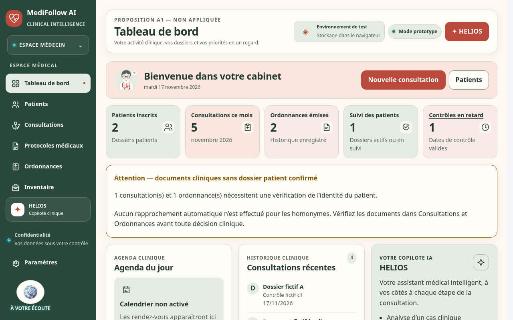
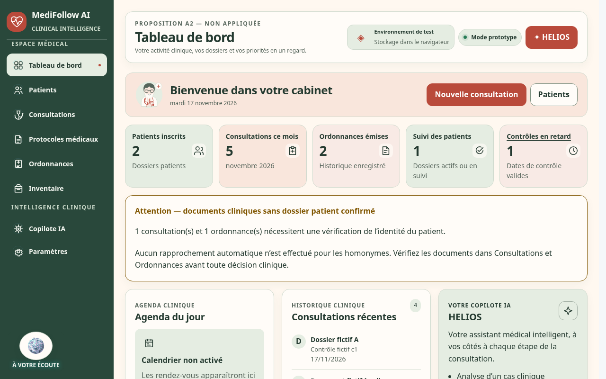
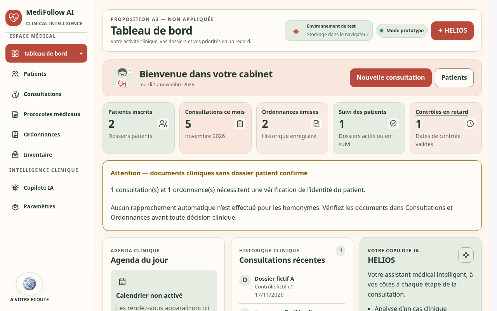
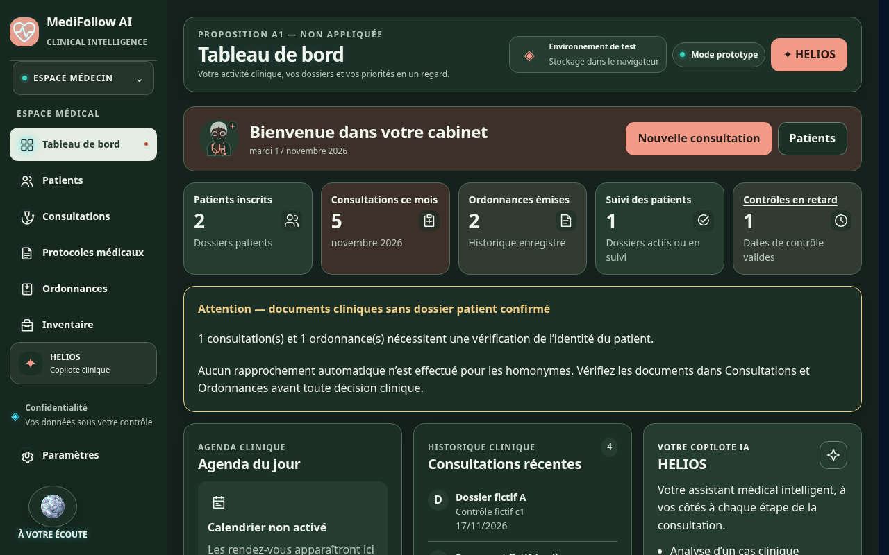
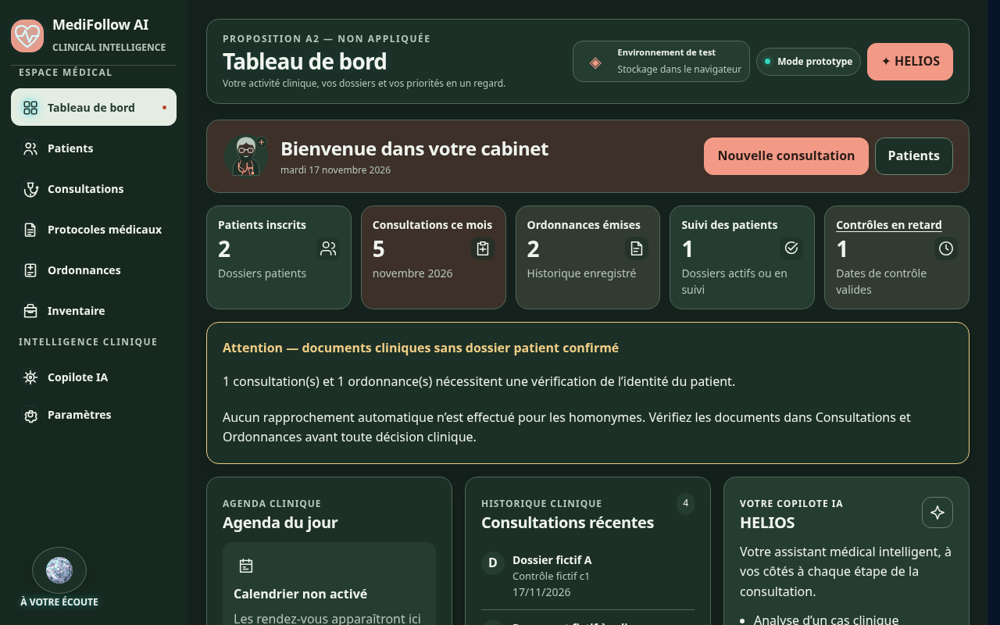
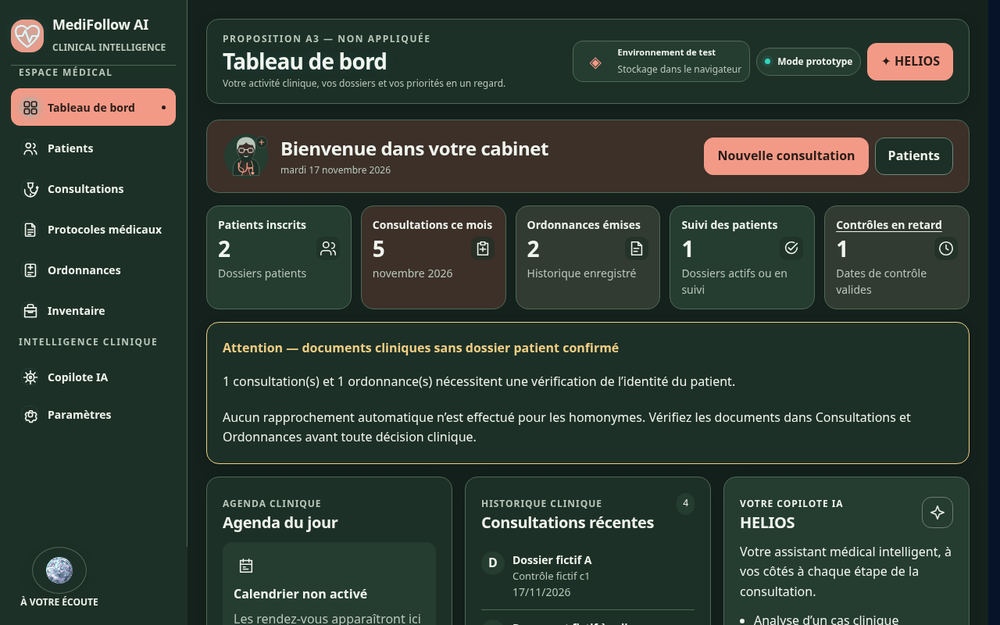

# Finition du menu — trois propositions dans la charte A

Ces aperçus viennent du navigateur Chromium, avec des données fictives et des styles injectés uniquement pour la comparaison. **Aucune variante n’est appliquée au code de l’application.** La palette du contenu, les champs, les données et les fonctions cliniques restent identiques.

Le menu actuel demande de défiler pour atteindre Paramètres en paysage 1280×800. Les trois variantes conservent les destinations existantes, les cibles de 48 px et le menu portrait natif.

| Choix | Différence | Compromis |
|---|---|---|
| **A1 — Paramètres ancré** | Forêt conservée, Paramètres fixe en bas ; carte HELIOS et texte de confidentialité conservés | La liste des pages défile dans l’espace restant. |
| **A2 — Menu direct (recommandé)** | Forêt conservée ; huit destinations visibles, Paramètres à la suite des pages | Les encarts redondants du menu sont retirés visuellement ; HELIOS reste accessible par Copilote IA et le bouton de l’en-tête. |
| **A3 — Menu lumineux** | Même organisation que A2 ; ivoire en clair, surface forêt adoucie en sombre, sélection corail | Donne plus de place visuelle au contenu et moins de contraste entre menu et page. |

Les trois aperçus cachent les informations statiques de pied de menu pour gagner de la hauteur. Le profil réel reste dans Paramètres. L’assistant vocal conserve son accès ; il n’a pas été activé durant ces captures.

## Paysage 1280×800 — clair

| A1 | A2 | A3 |
|---|---|---|
|  |  |  |

## Paysage 1280×800 — sombre

| A1 | A2 | A3 |
|---|---|---|
|  |  |  |

## Tous les formats

En portrait, le menu est ouvert pour voir les différences. Les captures restent des propositions, pas une validation de leur implémentation future.

| Format | Thème | Actuel | A1 | A2 | A3 |
|---|---|---|---|---|---|
| 1280x800 | light | [Voir](actuel-1280x800-light.png) | [Voir](a1-1280x800-light.png) | [Voir](a2-1280x800-light.png) | [Voir](a3-1280x800-light.png) |
| 1280x800 | dark | [Voir](actuel-1280x800-dark.png) | [Voir](a1-1280x800-dark.png) | [Voir](a2-1280x800-dark.png) | [Voir](a3-1280x800-dark.png) |
| 800x1280 | light | [Voir](actuel-800x1280-light.png) | [Voir](a1-800x1280-light.png) | [Voir](a2-800x1280-light.png) | [Voir](a3-800x1280-light.png) |
| 800x1280 | dark | [Voir](actuel-800x1280-dark.png) | [Voir](a1-800x1280-dark.png) | [Voir](a2-800x1280-dark.png) | [Voir](a3-800x1280-dark.png) |
| 360x740 | light | [Voir](actuel-360x740-light.png) | [Voir](a1-360x740-light.png) | [Voir](a2-360x740-light.png) | [Voir](a3-360x740-light.png) |
| 360x740 | dark | [Voir](actuel-360x740-dark.png) | [Voir](a1-360x740-dark.png) | [Voir](a2-360x740-dark.png) | [Voir](a3-360x740-dark.png) |

## Ce qui a réellement été contrôlé

24 captures : 6 états actuels et 18 propositions. Langue française et titre MediFollow réellement lus ; snapshots cliniques avant/après identiques ; aucune erreur de page, aucun débordement horizontal, huit destinations DOM et cibles de 48 px. Paramètres visible pour chaque proposition ; les huit destinations visibles pour A2/A3 dans les formats essayés. [Mesures complètes](metrics.json), [informations de capture](capture-info.json).

Le CSS de ce dossier est une expérience isolée, jamais importée par App. Les interactions complètes de ces variantes, l’appareil Android physique et un audit WCAG ne sont pas annoncés comme validés. Le choix définitif reste au propriétaire ; les éléments peuvent être combinés.

Reproduction locale, Playwright Python/Chromium déjà installés :

```bash
PYTHONDONTWRITEBYTECODE=1 python3 docs/cabinet-a-navigation-choices/preview.py
```

Le script vérifie que les sources applicatives sont celles de la livraison initiale ; seule la correction documentée de `index.html` est présente. Il refuse les futures sources modifiées. Les futures sessions doivent conserver ces preuves historiques et créer un nouveau dossier si le code évolue.
