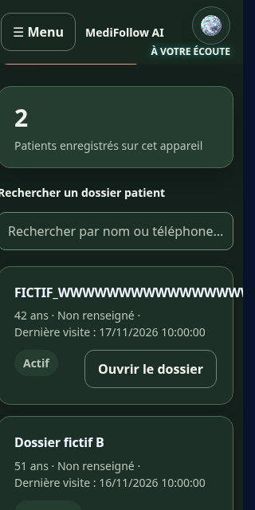
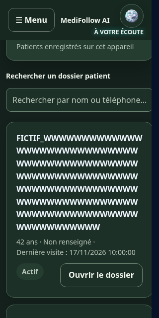
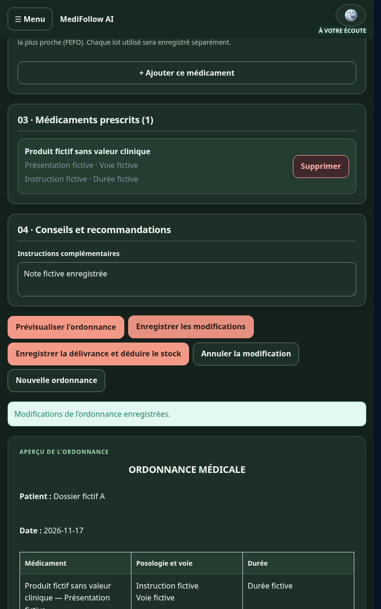
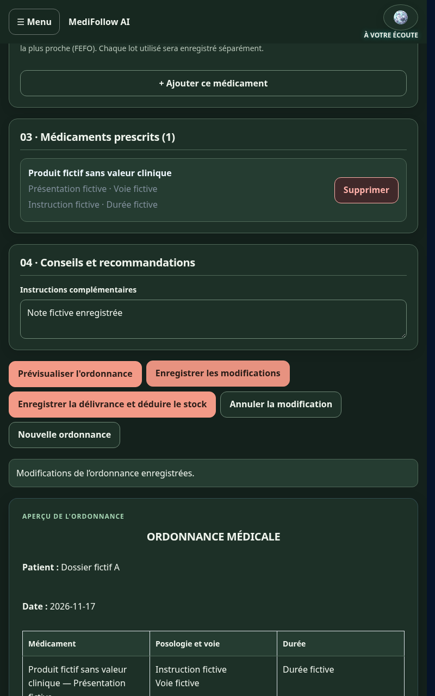
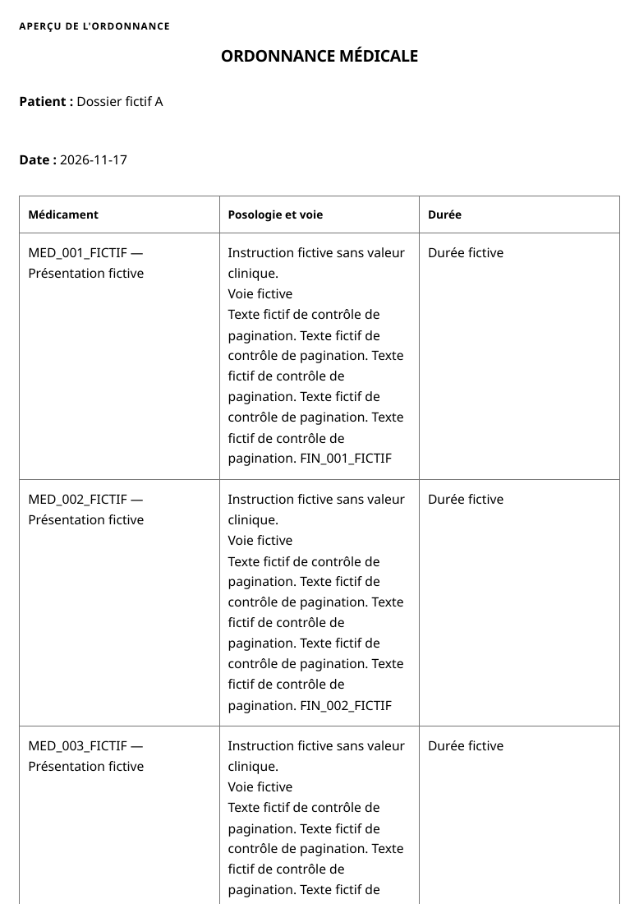
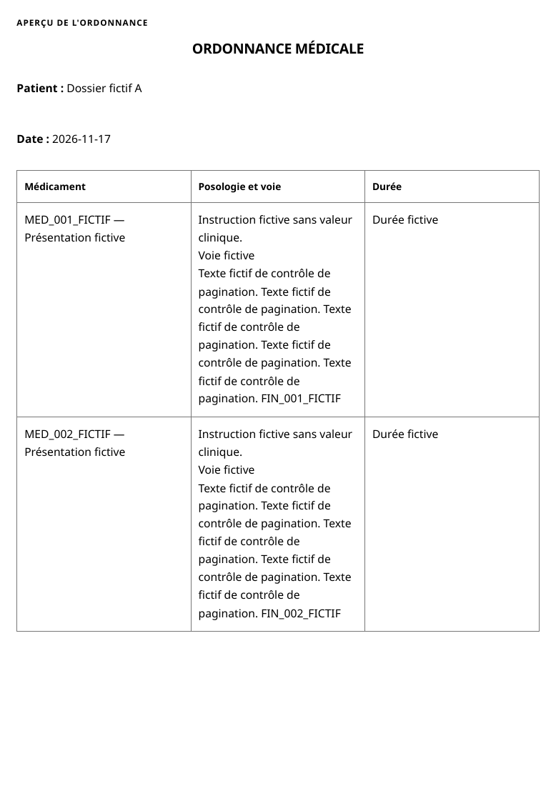

# Cabinet chaleureux A — session nocturne du 18 novembre 2026

Départ : `4beca9265513217b90687846cfe280e38ce2b6a5`. Commit de code testé : **`2ccebfb5cabc46f90259618719f48036ad0078c6`**. Les preuves historiques précédentes restent intactes. Le HEAD final, qui ajoute cette documentation, est indiqué dans la PR #18.

## Résultat et périmètre

Quatre corrections techniques dans la charte A approuvée :

1. **Textes longs lisibles** : `overflow-wrap:anywhere` sur le contenu évite qu’un nom, motif, article ou lot long soit coupé dans une carte. La largeur totale de page pouvait rester correcte malgré cette perte visuelle ; le test contrôle désormais les rectangles des descendants aussi. Valeurs et enregistrements inchangés.
2. **Messages d’ordonnance accessibles** : région `status` persistante, étiquetée, `aria-live=polite`, `aria-atomic=true`. Le conteneur `display:contents` conserve la disposition. Les propriétés sont vérifiées dans l’arbre d’accessibilité Chromium, sans prétendre avoir testé un lecteur d’écran physique.
3. **Contraste des retours de sauvegarde** : couleurs neutres de la charte A, avec texte d’origine. Le ratio passe de 4,03:1 à **10.18:1 en clair** et **10.74:1 en sombre**, pour succès et refus simulé. L’alerte globale d’échec de stockage reste présente et distincte.
4. **Impression et chargement** : lignes ordinaires de médicament conservées sur une page ; texte extrême autorisé à se répartir pour éviter de reporter la première ligne. Suppression d’un ancien import Google Fonts devenu inutile avec la police système de A ; le contrôle de non-régression couvre aussi la feuille CSS d’entrée.

Fichiers applicatifs/tests : `src/cabinet-a.css`, `src/index.css`, `src/pages/Prescriptions.tsx`, `scripts/test-cabinet-a.tsx` — 18 insertions et 6 suppressions. Aucun service, handler de sauvegarde, stockage, type médical, valeur ou commande vocale modifié. Les contrats cliniques existants passent. A1/A2/A3 restent des propositions non choisies et non importées.

## Contrôles réellement exécutés

| Contrôle final | Résultat | Preuve |
|---|---|---|
| `npm run test:complete`, build inclus | Réussi, code 0 | [Journal complet](logs/complete.log) |
| `npm run test:warm-design` | Réussi, code 0 | [Journal](logs/warm.log) |
| Suite navigateur ciblée | Cinq commandes réussies, code 0 | [Journal](logs/browser-suite.log), [empreintes des sources](final-run.json) |
| Accessibilité des huit pages | 16 états, aucun défaut ciblé détecté | [Mesures](baseline-after/results.json) |
| Responsive et textes longs | 48 états, zéro descendant hors du viewport | [Mesures](long-after/results.json) |
| Documents PDF | Six cas après correction, contenu et ordre conservés | [Court/long](print-after/results.json), [extrême](print-after-oversize/results.json) |
| Sauvegarde/refus de stockage | Deux parcours, quatre états de message | [Mesures](status-after/results.json) |
| Témoins de non-régression | Les deux commandes échouent comme attendu sur l’ancienne révision | [Résultats](negative-controls.json), [PDF avant](logs/print-before.log), [messages avant](logs/status-before.log) |

Les sources suivies de l’application, du serveur, des scripts et des manifests npm sont restées identiques pendant la suite finale ; les empreintes sont enregistrées. La vérification des preuves peut aussi comparer ces empreintes au checkout courant.

### Accessibilité et responsive

Activation au clavier des huit destinations, premier arrêt Tab sur le lien d’évitement, Entrée puis Tab vers le contenu, titre de document en français, un seul `main` et `h1`, destination active correcte, noms des contrôles dans le DOM et l’arbre AX. Pas de revendication d’un audit WCAG complet.

| Série | Format / thème |
|---|---|
| Clavier et sémantique | 1280×800 clair ; 800×1280 sombre |
| Textes longs et seuil de largeur | 700×600 clair ; 701×600 sombre |
| Seuil de hauteur | 1280×500 clair ; 1280×501 sombre |
| Formats intermédiaire et étroit | 1024×768 clair ; 320×640 sombre |

L’ancien code reproduit **35 états de contenu hors du viewport sur 48** malgré l’absence de débordement global. La mesure renforcée échoue sur ce témoin ; les mêmes 48 états passent après correction. Cette seconde passe corrige la conclusion trop limitée du premier contrôle de largeur. Les snapshots bruts de stockage restent identiques pendant les parcours de lecture.

### Sauvegarde, console et données

Chaque parcours modifie uniquement une note d’ordonnance fictive, puis simule un refus d’écriture. Le succès garde le document en brouillon ; les autres données médicales et le stock restent inchangés. Le refus ne modifie aucun enregistrement et affiche l’alerte de stockage. Les propriétés AX de la région sont `live=polite` et `atomic=true`.

L’ancien import de police provoquait une requête bloquée vers Google Fonts dans le harnais hors ligne. Après retrait : aucune requête échouée ni erreur console avant simulation dans ces parcours. L’erreur `QuotaExceededError` déclenchée volontairement est conservée dans les résultats. Des avertissements WebGL `ReadPixels` apparaissent lors de captures avec rendu logiciel ; le composant 3D est conservé, sans prétendre mesurer les performances Android.

### Pagination et intégrité PDF

Quatre témoins avant et six PDF après : court, 36 lignes avec instructions longues, et une ligne extrême, dans les deux thèmes. Les cas courts restent sur une page. Le cas de 36 lignes passe de 13 à 14 pages pour maintenir chaque ligne groupée : cinq lignes étaient scindées avant, aucune après. Ce changement privilégie la lecture du médicament avec ses instructions ; aucune réduction du nombre de pages n’est revendiquée.

Pour les colonnes dépassant 2 000 caractères, une classe de présentation rétablit le flux normal. Le cas extrême commence sur la première page et se répartit sur huit pages, avec contenu conservé. Ce seuil est une heuristique de pagination, sans interprétation clinique ; les autres longueurs et imprimantes physiques ne sont pas certifiées.

Les vérifications couvrent noms de patient et médicaments fictifs, ordre, mots attendus des instructions, limites de page et taille des mots repères. L’extraction texte simple mélangeait parfois les colonnes ; le contrôle utilise maintenant les coordonnées des mots et compare les tokens de la colonne de posologie. Il ne supprime aucune vérification de contenu. Une ligne trop haute pour une page peut se scinder ; elle ne doit pas être tronquée.

## Comparaisons réelles

### Nom fictif long — 320×640, sombre

| Avant | Après |
|---|---|
|  |  |

### Message de sauvegarde — 800×1280, sombre

| Avant | Après |
|---|---|
|  |  |

### PDF long, première page — données fictives

| Avant | Après |
|---|---|
|  |  |

**32 PNG** : 16 captures brutes Chromium et 16 rendus de pages PDF par Poppler. **10 PDF** : quatre témoins avant et six cas après. Aucune image générée ou retouchée.

| Cas | Clair | Sombre |
|---|---|---|
| Court après | [PDF](print-after/short-light.pdf) | [PDF](print-after/short-dark.pdf) |
| Long après | [PDF](print-after/long-light.pdf) | [PDF](print-after/long-dark.pdf) |
| Extrême après | [PDF](print-after-oversize/oversize-light.pdf) | [PDF](print-after-oversize/oversize-dark.pdf) |

Les captures avant/après utilisent les mêmes données fictives. Les témoins négatifs ont été rejoués dans un checkout détaché de `4beca926…`, sans changer la branche active. La source finale est `2ccebfb5cabc46f90259618719f48036ad0078c6`.

## Reproduction sans écraser les preuves

Vérifier les preuves enregistrées, sans navigateur ni serveur :

```bash
python3 docs/cabinet-a-night/2026-11-18-session-01/verify.py
```

Ajouter `--check-source` pour vérifier aussi que le checkout correspond aux empreintes du code testé.

Avec les dépendances installées, Chromium, Playwright Python et Poppler :

```bash
PYTHONDONTWRITEBYTECODE=1 python3 docs/cabinet-a-night/2026-11-18-session-01/run_checks.py
```

Les scripts refusent une source différente de [references.json](references.json). Ils créent par défaut leurs nouvelles preuves dans un dossier temporaire annoncé par la commande ; ils n’écrasent pas ce dossier historique. `MEDIFOLLOW_EVIDENCE_DIR` permet de choisir un autre dossier de sortie, et `MEDIFOLLOW_REPO` un checkout de référence. Les contrôles négatifs se rejouent sur le checkout avant avec `print_check.py before` et `status_check.py before` ; leur code de sortie attendu est 1. Le serveur reste local et s’arrête en fin de script.

Tous les contextes sont neufs, date fictive fixée au 17 novembre pour la comparaison, données entièrement fictives, requêtes externes et `/api/` bloquées. Aucun microphone ou fournisseur IA en direct.

## Limites et relais

Pas de tablette Android, lecteur d’écran matériel, microphone ou imprimante physique testés. Pas de validation clinique, audit WCAG complet ou benchmark de performance. L’avertissement Vite de bundle >500 ko reste présent.

Les variantes graphiques A1/A2/A3 attendent le propriétaire. L’audit indépendant du Council n’est pas remplacé par ces contrôles. Les tâches techniques ciblées de cette session sont achevées ; les reprises suivantes doivent rechercher de nouveaux retours autorisés, sans refaire les mêmes tests ni créer du travail artificiel. Un bilan cumulatif est prévu au passage final du matin.

PR #18 maintenue en brouillon, main/Premium/SWC-001/PR #6/PR #17 inchangés. Aucune fusion, aucun déploiement, dépense ou donnée réelle. Le statut GitHub du nouveau HEAD est consigné dans la PR après publication ; zéro workflow ne constitue pas une CI verte.
