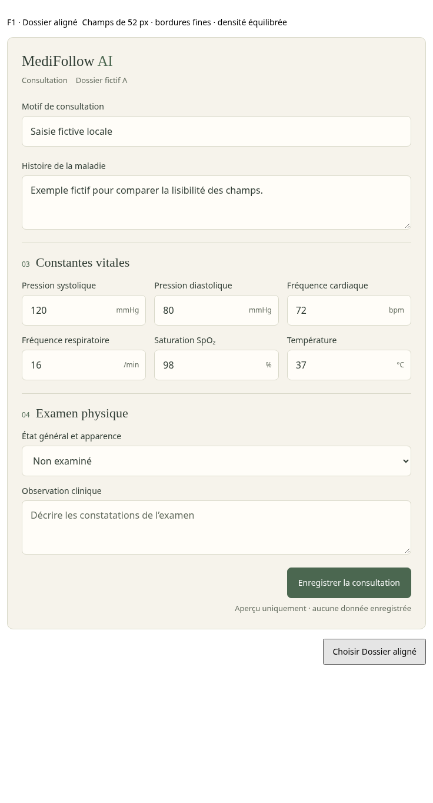
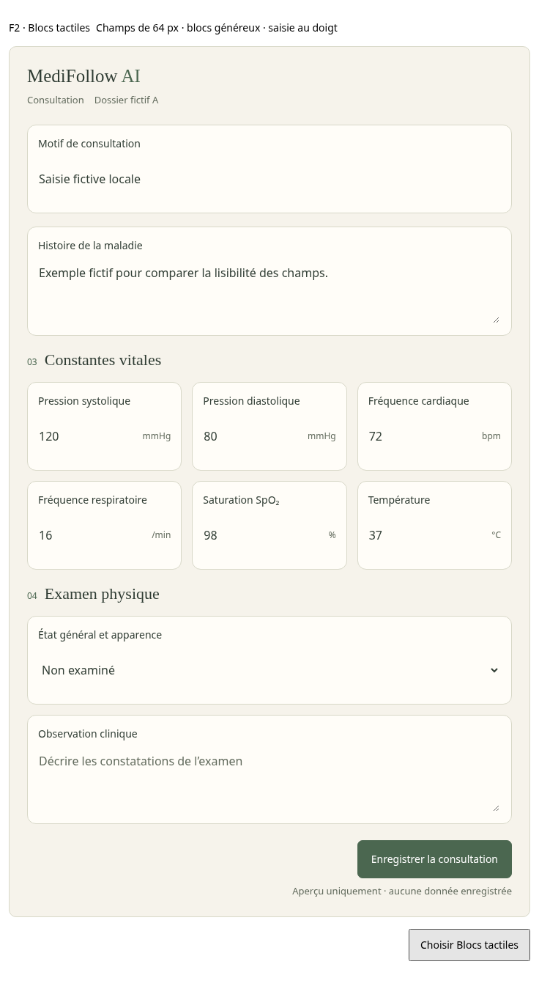
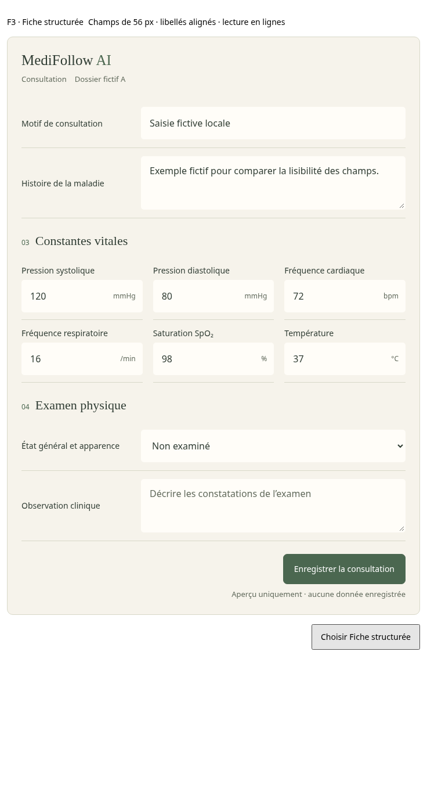

# Choix des champs médicaux

Maquettes de choix, sans modification du code de l’application. Palette C « Dossier essentiel » conservée. Données entièrement fictives.

## F1 — Dossier aligné

Champs de 52 px, bordures fines, libellés au-dessus des champs. Une disposition équilibrée.

[Version mobile sombre](f1-mobile-dark.png)

## F2 — Blocs tactiles

Champs de 64 px, blocs plus généreux et arrondis. Plus d’espace pour la saisie au doigt, avec davantage de défilement.

[Version mobile sombre](f2-mobile-dark.png)

## F3 — Fiche structurée

Champs de 56 px, libellés alignés à gauche et lecture en lignes. Les libellés passent au-dessus des champs sur téléphone.

[Version mobile sombre](f3-mobile-dark.png)

Les quatre états d’examen restent distincts : Non renseigné, Non examiné, Normal, Anormal. Ces aperçus ne sauvegardent pas de données et ne remplacent pas un test de l’application sur une tablette Android physique.

L’utilisateur peut choisir une proposition, combiner des détails ou conserver l’existant. Aucune refonte des champs n’est appliquée avant son choix.
