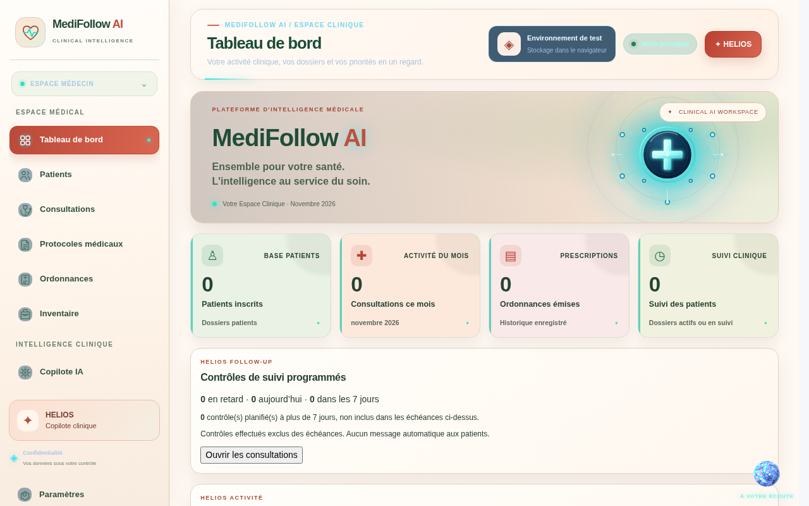
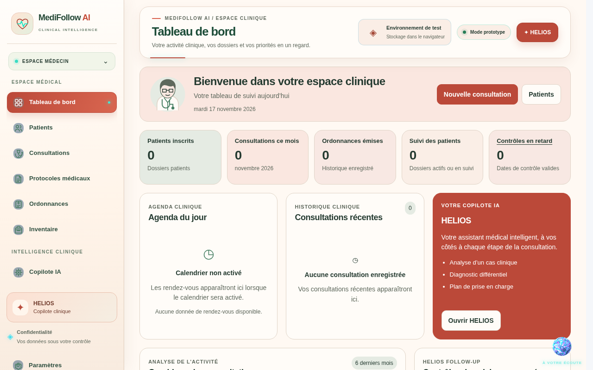
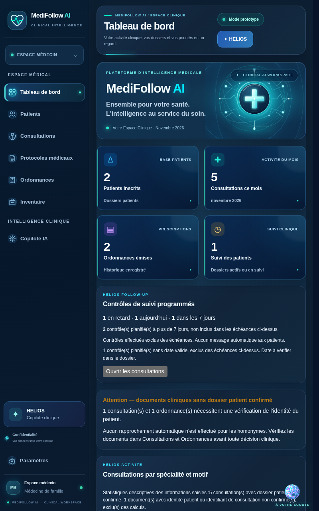
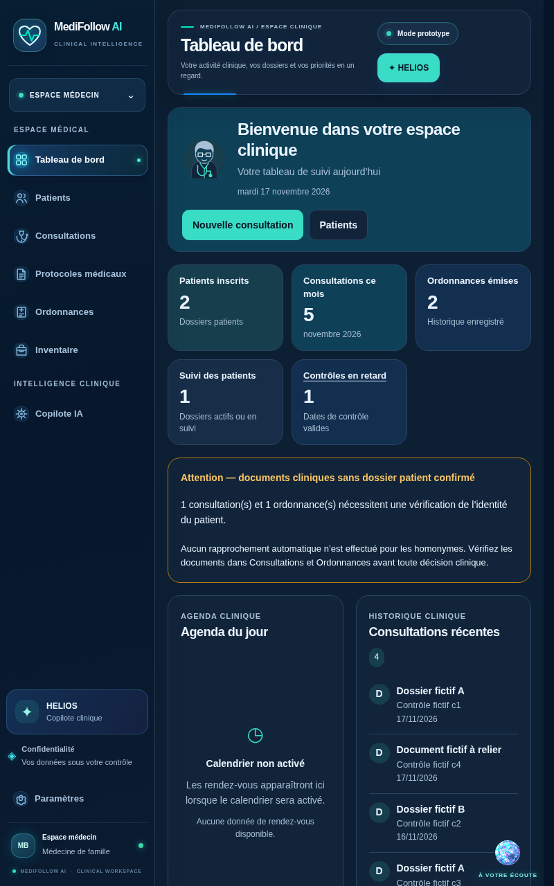
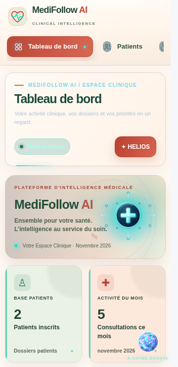
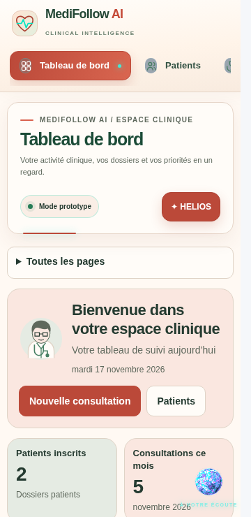

# LAB-UI-003 — Dashboard ivoire, corail et sauge

Refonte structurelle issue du [brief Council](../agent-relay/LAB-UI-003-CODEX-IMPLEMENTATION-BRIEF.md) et de son [schéma SVG](../agent-relay/LAB-UI-003-DASHBOARD-WIREFRAME.svg). Référence avant : `c898a89e16945d6bd7c2e7ab51fc928c2238c01a`. Implémentation testée : `cf721c82680f8fcdae6e76d3547a86daa2eca9d9`.

**Images ci-dessous : captures réelles Chromium de l’application, sans génération ni retouche.** Deux scénarios : stockage vide et dossiers entièrement fictifs. Aucun agenda ou chiffre de patient n’est inventé dans le code applicatif.

[Rapport détaillé et limites](RAPPORT.md) · [Vérification des preuves](compare.py) · [Navigation](interactions.json) · [Thème auto et reflow](extras.json) · [Rafraîchissement](refresh.json)

## Paysage 1280×800 — clair, stockage vide

| Avant | LAB-UI-003 |
|---|---|
|  |  |

[Vues complètes avant](avant/vide-1280x800-light-complet.png) · [Après](apres/vide-1280x800-light-complet.png)

## Tablette portrait 800×1280 — sombre, dossiers fictifs

| Avant | LAB-UI-003 |
|---|---|
|  |  |

[Vues complètes avant](avant/fictif-800x1280-dark-complet.png) · [Après](apres/fictif-800x1280-dark-complet.png)

## Téléphone 360×740 — clair, dossiers fictifs

| Avant | LAB-UI-003 |
|---|---|
|  |  |

[Vues complètes avant](avant/fictif-360x740-light-complet.png) · [Après](apres/fictif-360x740-light-complet.png)

## Disposition large de référence

[Après à 1648×928, clair](apres/vide-1648x928-light.png) · [Avec dossiers fictifs](apres/fictif-1648x928-light.png) · [Page complète avec données fictives](apres/fictif-1648x928-light-complet.png)

## Toutes les comparaisons

64 captures : deux jeux de données × quatre dimensions × deux thèmes × avant/après × vue initiale/page complète.

| Données | Dimensions | Thème | Avant | Après | Avant complet | Après complet |
|---|---|---|---|---|---|---|
| vide | 1280x800 | light | [Voir](avant/vide-1280x800-light.png) | [Voir](apres/vide-1280x800-light.png) | [Voir](avant/vide-1280x800-light-complet.png) | [Voir](apres/vide-1280x800-light-complet.png) |
| vide | 1280x800 | dark | [Voir](avant/vide-1280x800-dark.png) | [Voir](apres/vide-1280x800-dark.png) | [Voir](avant/vide-1280x800-dark-complet.png) | [Voir](apres/vide-1280x800-dark-complet.png) |
| vide | 800x1280 | light | [Voir](avant/vide-800x1280-light.png) | [Voir](apres/vide-800x1280-light.png) | [Voir](avant/vide-800x1280-light-complet.png) | [Voir](apres/vide-800x1280-light-complet.png) |
| vide | 800x1280 | dark | [Voir](avant/vide-800x1280-dark.png) | [Voir](apres/vide-800x1280-dark.png) | [Voir](avant/vide-800x1280-dark-complet.png) | [Voir](apres/vide-800x1280-dark-complet.png) |
| vide | 360x740 | light | [Voir](avant/vide-360x740-light.png) | [Voir](apres/vide-360x740-light.png) | [Voir](avant/vide-360x740-light-complet.png) | [Voir](apres/vide-360x740-light-complet.png) |
| vide | 360x740 | dark | [Voir](avant/vide-360x740-dark.png) | [Voir](apres/vide-360x740-dark.png) | [Voir](avant/vide-360x740-dark-complet.png) | [Voir](apres/vide-360x740-dark-complet.png) |
| vide | 1648x928 | light | [Voir](avant/vide-1648x928-light.png) | [Voir](apres/vide-1648x928-light.png) | [Voir](avant/vide-1648x928-light-complet.png) | [Voir](apres/vide-1648x928-light-complet.png) |
| vide | 1648x928 | dark | [Voir](avant/vide-1648x928-dark.png) | [Voir](apres/vide-1648x928-dark.png) | [Voir](avant/vide-1648x928-dark-complet.png) | [Voir](apres/vide-1648x928-dark-complet.png) |
| fictif | 1280x800 | light | [Voir](avant/fictif-1280x800-light.png) | [Voir](apres/fictif-1280x800-light.png) | [Voir](avant/fictif-1280x800-light-complet.png) | [Voir](apres/fictif-1280x800-light-complet.png) |
| fictif | 1280x800 | dark | [Voir](avant/fictif-1280x800-dark.png) | [Voir](apres/fictif-1280x800-dark.png) | [Voir](avant/fictif-1280x800-dark-complet.png) | [Voir](apres/fictif-1280x800-dark-complet.png) |
| fictif | 800x1280 | light | [Voir](avant/fictif-800x1280-light.png) | [Voir](apres/fictif-800x1280-light.png) | [Voir](avant/fictif-800x1280-light-complet.png) | [Voir](apres/fictif-800x1280-light-complet.png) |
| fictif | 800x1280 | dark | [Voir](avant/fictif-800x1280-dark.png) | [Voir](apres/fictif-800x1280-dark.png) | [Voir](avant/fictif-800x1280-dark-complet.png) | [Voir](apres/fictif-800x1280-dark-complet.png) |
| fictif | 360x740 | light | [Voir](avant/fictif-360x740-light.png) | [Voir](apres/fictif-360x740-light.png) | [Voir](avant/fictif-360x740-light-complet.png) | [Voir](apres/fictif-360x740-light-complet.png) |
| fictif | 360x740 | dark | [Voir](avant/fictif-360x740-dark.png) | [Voir](apres/fictif-360x740-dark.png) | [Voir](avant/fictif-360x740-dark-complet.png) | [Voir](apres/fictif-360x740-dark-complet.png) |
| fictif | 1648x928 | light | [Voir](avant/fictif-1648x928-light.png) | [Voir](apres/fictif-1648x928-light.png) | [Voir](avant/fictif-1648x928-light-complet.png) | [Voir](apres/fictif-1648x928-light-complet.png) |
| fictif | 1648x928 | dark | [Voir](avant/fictif-1648x928-dark.png) | [Voir](apres/fictif-1648x928-dark.png) | [Voir](avant/fictif-1648x928-dark-complet.png) | [Voir](apres/fictif-1648x928-dark-complet.png) |

## Focus et reflow

Six vues de focus clavier, plus deux vues à 640×400 reproduisant le reflow équivalent à un agrandissement de 200 % depuis 1280×800. Ce dernier contrôle ne représente pas un essai du zoom natif de Chrome ni un test Android physique.

- Focus 1280x800 : [clair](focus-1280x800-light.png) · [sombre](focus-1280x800-dark.png)
- Focus 800x1280 : [clair](focus-800x1280-light.png) · [sombre](focus-800x1280-dark.png)
- Focus 360x740 : [clair](focus-360x740-light.png) · [sombre](focus-360x740-dark.png)
- Reflow équivalent 200 % : [clair](reflow-200-equivalent-light.png) · [sombre](reflow-200-equivalent-dark.png)
