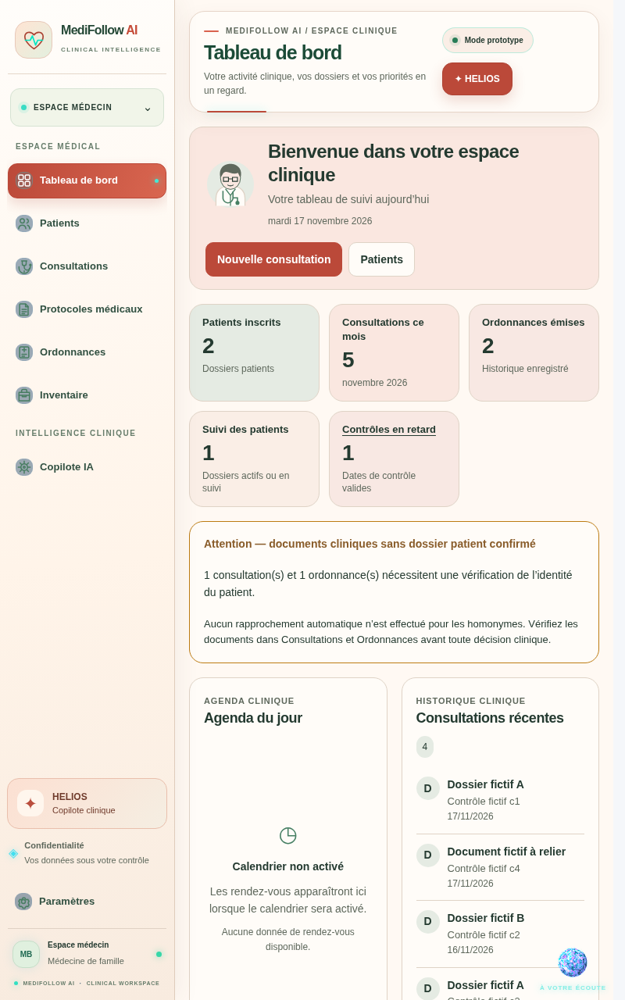
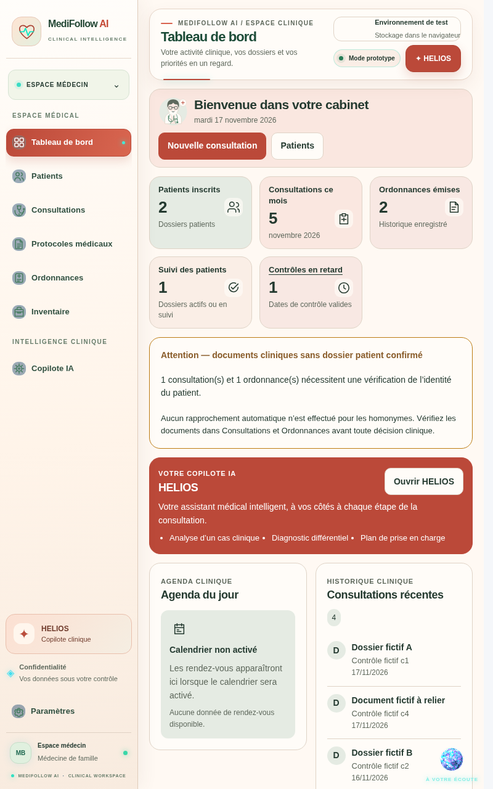
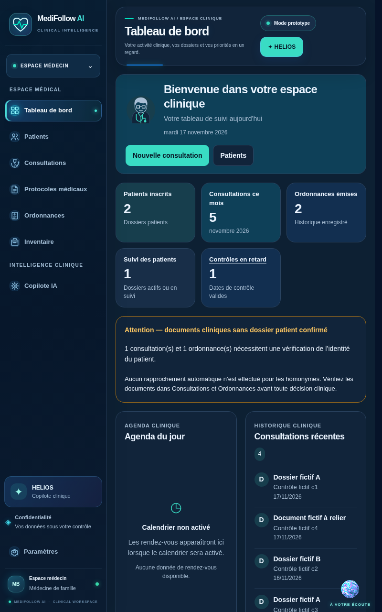
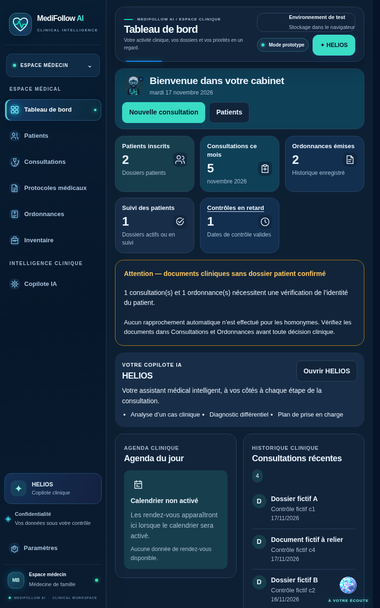
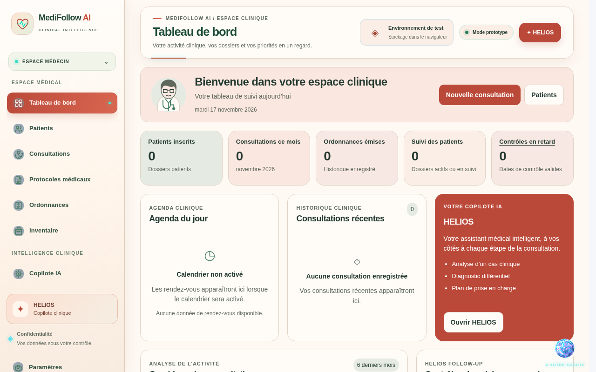
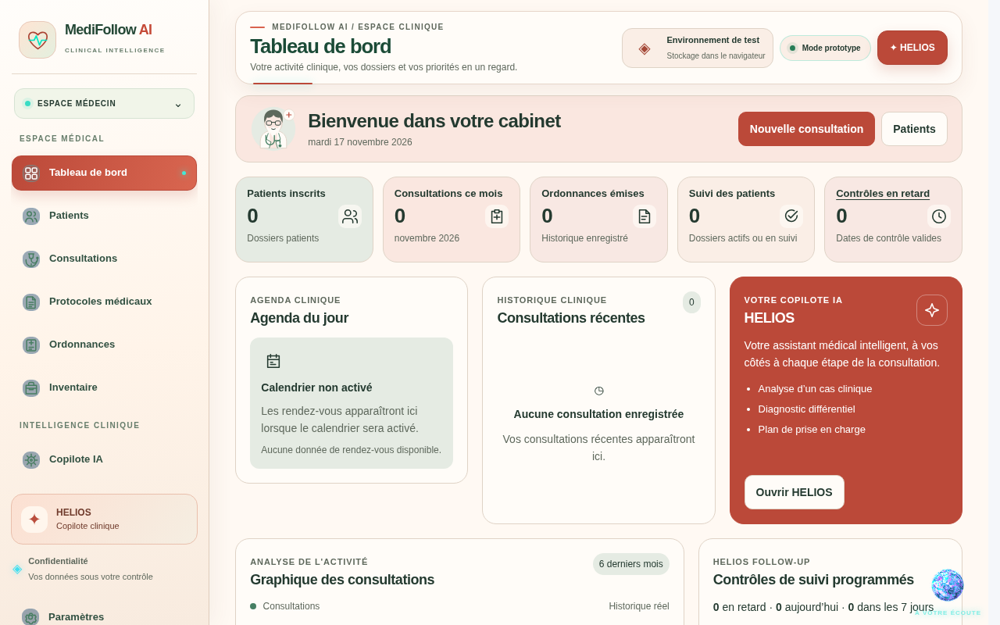
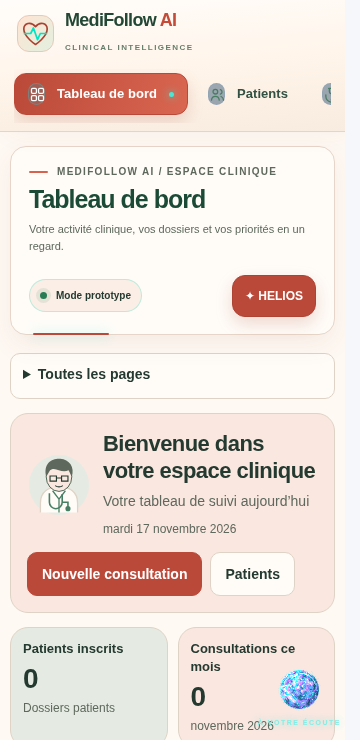
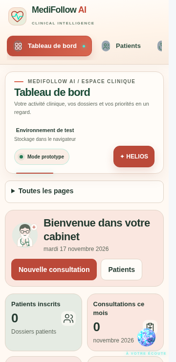

# LAB-UI-003A — Comparer la correction du Council

La PR #17 reste en brouillon. Captures originales de Chromium, sans génération d’image ni retouche. Avant : HEAD audité `d8290ad300d5ddd31ac6cc23290f43fe5fef76c0`. Après : code `3ee0ee2f6f0a9853773f9d87d400c6ced5fc2a64`.

Le jeu « fictif » contient uniquement des dossiers de démonstration. L’alerte d’identité reste volontairement présente. La date est figée dans le test, jamais dans l’application.

## Tablette portrait — 800×1280, clair, dossiers fictifs

HELIOS apparaît dans le premier écran, après l’alerte complète, avant l’Agenda et les consultations.

| Avant correction | Après correction |
|---|---|
|  |  |

## Tablette portrait — thème sombre

| Avant correction | Après correction |
|---|---|
|  |  |

## Écran large — 1280×800, clair

| Avant correction | Après correction |
|---|---|
|  |  |

## Téléphone — 360×740, clair

| Avant correction | Après correction |
|---|---|
|  |  |

## Toutes les configurations

Chaque entrée propose la vue initiale et la page complète, sans masquer les panneaux cliniques.

| Données | Dimensions | Thème | Avant | Après |
|---|---|---|---|---|
| vide | 1280x800 | light | [Vue](avant/vide-1280x800-light.png) · [Complète](avant/vide-1280x800-light-complet.png) | [Vue](apres/vide-1280x800-light.png) · [Complète](apres/vide-1280x800-light-complet.png) |
| vide | 1280x800 | dark | [Vue](avant/vide-1280x800-dark.png) · [Complète](avant/vide-1280x800-dark-complet.png) | [Vue](apres/vide-1280x800-dark.png) · [Complète](apres/vide-1280x800-dark-complet.png) |
| vide | 800x1280 | light | [Vue](avant/vide-800x1280-light.png) · [Complète](avant/vide-800x1280-light-complet.png) | [Vue](apres/vide-800x1280-light.png) · [Complète](apres/vide-800x1280-light-complet.png) |
| vide | 800x1280 | dark | [Vue](avant/vide-800x1280-dark.png) · [Complète](avant/vide-800x1280-dark-complet.png) | [Vue](apres/vide-800x1280-dark.png) · [Complète](apres/vide-800x1280-dark-complet.png) |
| vide | 360x740 | light | [Vue](avant/vide-360x740-light.png) · [Complète](avant/vide-360x740-light-complet.png) | [Vue](apres/vide-360x740-light.png) · [Complète](apres/vide-360x740-light-complet.png) |
| vide | 360x740 | dark | [Vue](avant/vide-360x740-dark.png) · [Complète](avant/vide-360x740-dark-complet.png) | [Vue](apres/vide-360x740-dark.png) · [Complète](apres/vide-360x740-dark-complet.png) |
| vide | 1648x928 | light | [Vue](avant/vide-1648x928-light.png) · [Complète](avant/vide-1648x928-light-complet.png) | [Vue](apres/vide-1648x928-light.png) · [Complète](apres/vide-1648x928-light-complet.png) |
| vide | 1648x928 | dark | [Vue](avant/vide-1648x928-dark.png) · [Complète](avant/vide-1648x928-dark-complet.png) | [Vue](apres/vide-1648x928-dark.png) · [Complète](apres/vide-1648x928-dark-complet.png) |
| fictif | 1280x800 | light | [Vue](avant/fictif-1280x800-light.png) · [Complète](avant/fictif-1280x800-light-complet.png) | [Vue](apres/fictif-1280x800-light.png) · [Complète](apres/fictif-1280x800-light-complet.png) |
| fictif | 1280x800 | dark | [Vue](avant/fictif-1280x800-dark.png) · [Complète](avant/fictif-1280x800-dark-complet.png) | [Vue](apres/fictif-1280x800-dark.png) · [Complète](apres/fictif-1280x800-dark-complet.png) |
| fictif | 800x1280 | light | [Vue](avant/fictif-800x1280-light.png) · [Complète](avant/fictif-800x1280-light-complet.png) | [Vue](apres/fictif-800x1280-light.png) · [Complète](apres/fictif-800x1280-light-complet.png) |
| fictif | 800x1280 | dark | [Vue](avant/fictif-800x1280-dark.png) · [Complète](avant/fictif-800x1280-dark-complet.png) | [Vue](apres/fictif-800x1280-dark.png) · [Complète](apres/fictif-800x1280-dark-complet.png) |
| fictif | 360x740 | light | [Vue](avant/fictif-360x740-light.png) · [Complète](avant/fictif-360x740-light-complet.png) | [Vue](apres/fictif-360x740-light.png) · [Complète](apres/fictif-360x740-light-complet.png) |
| fictif | 360x740 | dark | [Vue](avant/fictif-360x740-dark.png) · [Complète](avant/fictif-360x740-dark-complet.png) | [Vue](apres/fictif-360x740-dark.png) · [Complète](apres/fictif-360x740-dark-complet.png) |
| fictif | 1648x928 | light | [Vue](avant/fictif-1648x928-light.png) · [Complète](avant/fictif-1648x928-light-complet.png) | [Vue](apres/fictif-1648x928-light.png) · [Complète](apres/fictif-1648x928-light-complet.png) |
| fictif | 1648x928 | dark | [Vue](avant/fictif-1648x928-dark.png) · [Complète](avant/fictif-1648x928-dark-complet.png) | [Vue](apres/fictif-1648x928-dark.png) · [Complète](apres/fictif-1648x928-dark-complet.png) |

## Focus, reflow et échec de sauvegarde

- Focus 1280x800 : [clair](focus-1280x800-light.png) · [sombre](focus-1280x800-dark.png).
- Focus 800x1280 : [clair](focus-800x1280-light.png) · [sombre](focus-800x1280-dark.png).
- Focus 360x740 : [clair](focus-360x740-light.png) · [sombre](focus-360x740-dark.png).
- Reflow équivalent à 200 % : [clair](reflow-200-equivalent-light.png) · [sombre](reflow-200-equivalent-dark.png). Zoom natif Chrome non testé.
- [Avertissement de sauvegarde réellement déclenché](storage-alert-800x1280-light.png) : maintien du message, de l’alerte d’identité et de l’accès HELIOS.

[Rapport et résultats](RAPPORT.md) · [Vérifier les mesures enregistrées](compare.py) · [Contrôles spécifiques Council](council.json).
